  

<h1 align="center">Musa Sarfraz</h1>

<i>I box. I write. I play. I draw. And I code.</i>

  
  
  
  

  I build AI backends with <b>FastAPI</b> and scrape the web for a living. 
  Off the keyboard I box, write poetry, play piano and sketch. 
  I wrote a book called <i>All This Grief</i>.

## What I build

- **AI backends.** FastAPI services, agentic RAG with LangGraph, and natural-language-to-SQL agents.
- **Scraping and data pipelines.** Async crawlers that turn messy websites into clean, deduplicated, scored records in PostgreSQL.
- **QA automation.** Browser and API test suites with Playwright and pytest.

## Selected work

| Project | What it is |
| --- | --- |
| [BuildLead](https://github.com/MusaSarfraz/BuildLead) | Async B2B lead pipeline. Crawls company sites, extracts and validates contacts, scores lead completeness, stores to PostgreSQL, serves a FastAPI REST API. Docker, tests and CI included. |
| [EmailSender](https://github.com/MusaSarfraz/Automated-email_sender-app) | Windows desktop app that sends personalised emails from Excel or Google Sheets through your own Gmail or Outlook, and resumes safely after a crash without duplicate sends. |
| [Automata Lab](https://github.com/MusaSarfraz/Theory-of-Automata-Visualizer) | FastAPI web app for learning Theory of Automata: step-by-step DFA and NFA runs, NFA to DFA, minimization, and regex to automaton. |
| [Musami Web QA](https://github.com/MusaSarfraz/musami_webQA) | Playwright and pytest suite covering login, search, cart, checkout and API validation, with a page-object structure. |
| [DocChat](https://github.com/MusaSarfraz/Doc_chat_Agentic_RAG) | Multi-agent LangGraph workflow that answers questions over your documents and verifies the answer against the sources. Built from an IBM and Coursera lab, then reorganised. |
| [SQL Agent](https://github.com/MusaSarfraz/langchain-sql-agent) | Ask a database questions in plain English with IBM Granite, LangChain and MySQL. |

## Stand stats

  

## The book

<table>
  <tr>
    <td width="170"></td>
    <td>
      <b><i>All This Grief</i></b>  
      <i>Perhaps to live is to lose a lot.</i>  
      A book I wrote. Poetry and writing are where I put the things I can't put into code.  
      <a href="https://www.amazon.com/All-This-Grief-MUSA-SARFRAZ-ebook/dp/B0HJLD86QP">Read it on Amazon</a> · <a href="https://www.instagram.com/musas_draft/">Drafts on Instagram</a>
    </td>
  </tr>
</table>

## Off the keyboard

- **Boxing.** The heavy bag keeps my head clear.
- **Poetry and writing.** The words go into my book.
- **Piano.** I play at night.
- **Sketching.** Pencil, paper and slow lines.
